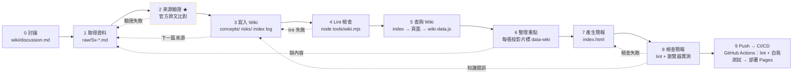

# Loop / Graph 設計與反思

> 對應作業步驟三（說明 loop/graph 設計）與步驟四（反思）。簡報第 16、17 張是這份文件的互動版。

## 1. 整體流程（graph）

## 2. 資訊怎麼被取得、整理、檢查、產生

| 階段 | 做什麼 | 產物 | 誰檢查 |
|---|---|---|---|
| 取得 | 5 個 web-fetch 子代理平行抓 S1–S5；S6 交叉比對。官方 PDF 用 `pdftotext -layout` 本機抽文字。 | `raw/S1…S6.md`（改寫筆記 + URL + 可信度） | 來源驗證 |
| 驗證 ★ | 名稱、數字、對照表都要在官方原文找到出處；二手來源只比對、不採用。 | raw 筆記的「勘誤」段 | 人工 + grep 原文 |
| 整理 | 依 `AGENTS.md` 固定格式寫頁：新手一句話 → 生活比喻 → 怎麼發生 → 官方情境 → 怎麼防 → 對照 → 相關 | `wiki/` 22 頁 | Lint |
| 檢查 | `tools/wiki.mjs`：斷鏈、孤兒頁、缺 sources、來源不存在、ASI 官方名稱、段落是否抽得到、簡報 data-wiki 是否存在 | `graph/graph.json`、`graph/wiki-data.js` | exit code |
| 產生 | 簡報讀 `wiki-data.js` 自動產生風險卡、測驗、對照矩陣、知識圖譜；其他頁從概念頁改寫並標 `data-wiki` | `index.html` | Lint 第 6 項 + 瀏覽器 |

## 3. 哪些步驟會重複？

- **1→2→3（每篇來源一次）**：共 6 篇，每篇 ingest 後都要驗證、再更新相關頁。一篇來源常會改到 3–10 頁（例如 S1 改到全部 risk 頁）。
- **3↔4（直到 lint 通過）**：每次寫完 Wiki 就跑 lint；失敗就回去修頁面。
- **5→6（每張投影片一次）**：每張投影片都先查 index、再讀頁面。
- **7↔8（直到檢查通過）**：簡報改一次就重跑 lint + 瀏覽器檢查。

## 4. 哪些地方需要檢查或重新生成？

| 檢查點 | 失敗時 | 理由 |
|---|---|---|
| 2 來源驗證 | 回到 1：重抓或換讀法（例如 PDF 改用 pdftotext） | 錯誤越早攔越便宜：錯的對照表一旦寫進 Wiki，會被 10 張卡片、矩陣、測驗複製出去 |
| 4 Lint | 回到 3：修頁面，不放寬程式 | Wiki 是唯一事實來源；簡報是「編譯」出來的，格式必須一致 |
| 6 整理重點 | Wiki 沒有的內容 → 回到 1 補 ingest | 不讓 AI 用記憶補內容（會產生無來源的說法） |
| 8 檢查簡報 | 版面/互動錯 → 回到 7；內容錯 → 回到 3 改 Wiki 再重產 | 內容錯在 Wiki 修，簡報才不會和 Wiki 分歧 |

## 5. 為什麼這樣設計？

1. **Wiki 當唯一事實來源**：簡報不手抄內容，而是從 Wiki 抽資料產生。改一處 Wiki，重跑 `node tools/wiki.mjs` 就同步到簡報與圖譜。
2. **把檢查做成程式**：人工檢查會漏；lint 有 exit code，能當 push 前的關卡。
3. **graph 不只是裝飾**：知識圖譜的孤兒頁與斷鏈就是 lint 的檢查項，graph 本身就是品質指標（例如 `least-agency` 連到 17 個節點，表示它是全簡報的樞紐概念）。
4. **官方優先、二手只比對**：OWASP 主題的網路文章很多版本混雜，必須有明確的可信度規則。

## 6. 反思（實際跑一次之後）

### 哪一個節點最常出錯？
**1 取得資料（Ingest）**，共 3 個問題：
1. WebFetch 讀官方 PDF 只拿到壓縮亂碼，子代理回報「找不到 T1–T15、找不到緩解措施」。
2. 二手文章對 Threats & Mitigations 的數量說法不一（15 vs 17）——其實是 v1.0 與 v1.1 的版本差。
3. 我自己依名稱推論的 T↔ASI 對照表，17 列中 5 列配錯、7 列漏列（例如把 T15 Human Manipulation 配給 ASI09，官方 Appendix A 是 ASI10）。

第二多的是 **8 檢查簡報**：lint 的名稱檢查本身有 bug（變異測試才發現）、`#5` 網址換頁失效、workflow 圖 loop 標籤被裁掉。

### 發現問題後，把檢查往前移到哪個步驟？
- 原本的想法是「做完簡報再一起檢查」。實際發現錯誤源頭在 ingest，所以：
  - 新增 **2 來源驗證**，放在 **寫入 Wiki 之前**：任何數字、名稱、對照都要在官方原文找到出處。
  - 把 **Lint 移到產生簡報之前**，並讓 lint 腳本同時負責「抽出簡報資料」：Wiki 格式不對，簡報資料就產不出來，不會出現空白卡片。

### 有沒有因此修改 workflow / graph？為什麼？
有，三處：
1. **graph 加一個節點**：「2 來源驗證」與它的 loop（驗證失敗 → 回 1）。因為最常出錯的是 ingest，檢查要貼著錯誤源頭。
2. **簡報改成從 Wiki 自動抽取**：第一次 lint 就抓到 4 個風險頁的「官方情境」格式不一致；選擇修頁面、不放寬 parser，讓格式本身成為規則。
3. **檢查也要被檢查**：加入變異測試（故意寫錯官方名稱，確認 lint 會報錯），因為一個永遠通過的檢查等於沒有檢查。

完整的時間序紀錄見 [`wiki/log.md`](../wiki/log.md)。
